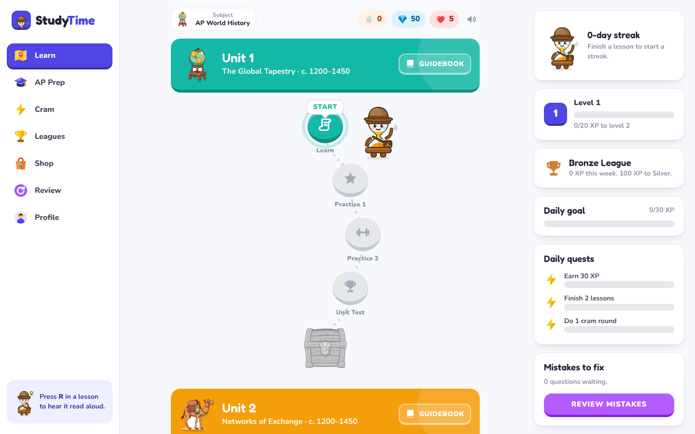
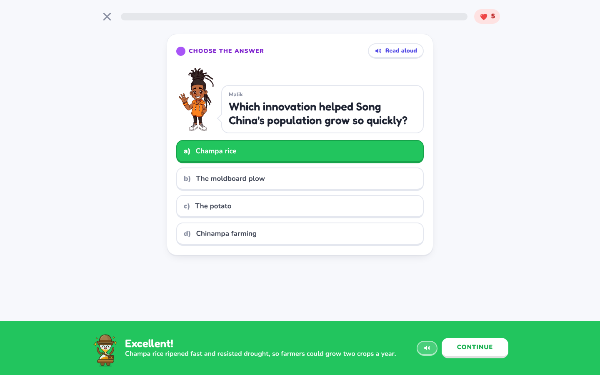
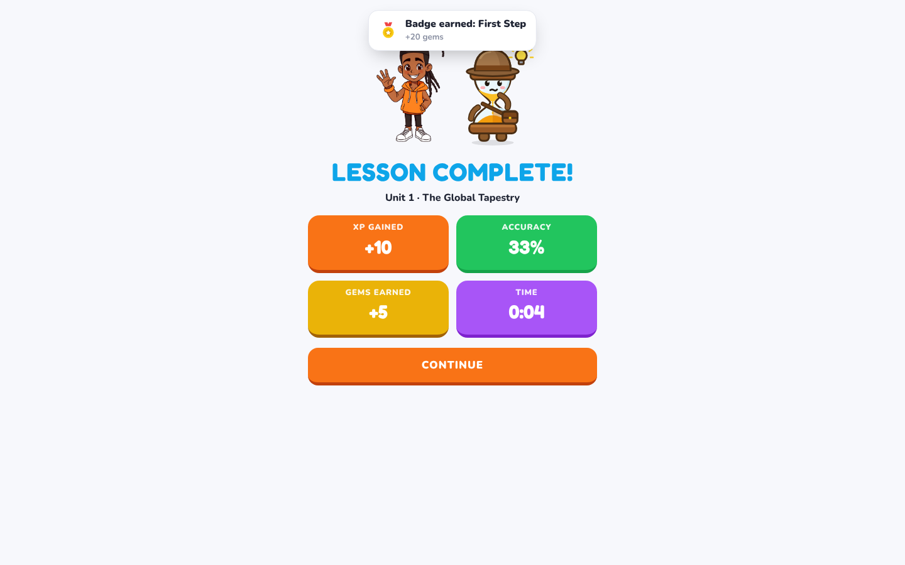
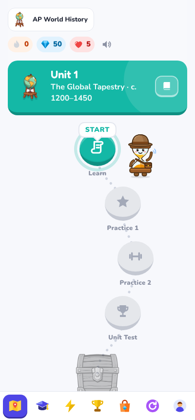

# StudyTime

A gamified study app for **school subjects, languages, coding, money and tech**, built as a Windows desktop app.
Lessons are laid out on a path like a language-learning app, with short Khan-style notes before each unit.

**111 courses · 3,000+ questions**, picked from five columns:

| Academics | Languages | Coding | Money & Business | Tech & Computers |
| --- | --- | --- | --- | --- |
| Math grades 3–8, Algebra 1 & 2, Geometry, Precalc, Calculus, Statistics · English grades 3–12 · Science grades 3–8, Biology, Chemistry, Physics, Environmental · US & World History, Civics, Geography · AP World, AP US History, AP Bio, Chem, Calc AB, Psych, Gov, English Lang, Macro · Psychology | Spanish, French, German, Italian, Portuguese, Russian, Japanese, Mandarin, Korean, Arabic, Hindi, English (each Beginner + Intermediate) | Coding Basics, Python, JavaScript, TypeScript, HTML & CSS, Java, C, C++, C#, Go, Rust, Swift, Kotlin, PHP, Ruby, SQL, Bash, Git, Lua & Roblox Luau, R, Algorithms | Personal Finance, Investing & Stocks, Crypto, Micro & Macroeconomics, Business Basics, Entrepreneurship, Marketing, Accounting, Real Estate, Taxes | Computer Basics, How the Internet Works, Cybersecurity, AI & Machine Learning, Networking, PC Hardware, Cloud |



## What's inside

- **Lesson path**: every course has 4+ units; each unit has Learn, Practice 1, Practice 2, Unit Test and a treasure chest.
- **Question types**: multiple choice, true/false, tap-to-match pairs, put-events-in-order, AP source (stimulus) questions.
- **AP Prep**: timed Exam Sim with a 1–5 score estimate, Source Drills, Unit Focus.
- **Cram**: Lightning Round (60 s), Date Dash, Flashcards, Cram Sheet.
- **Game layer**: XP, levels, gems, hearts, streaks, streak freezes, combos, weekly leagues, 12 badges, a shop, confetti and sound effects.
- **Read aloud**: every question, explanation and note can be read out loud, with voice, speed and pitch settings (press **R** in a lesson).
- **Characters**: Tock the hourglass explorer (vector mascot, 7 moods) and a study crew of 7 original characters who ask the questions.

| Lesson | Results | Phone width |
| --- | --- | --- |
|  |  |  |

## Get the app

Every push to `main` builds a Windows installer on GitHub Actions:
**Actions → Build Windows app → latest run → Artifacts → StudyTime-Windows**.
Tagging a version (for example `v1.0.0`) also attaches the installer to a GitHub Release.

## Develop

```bash
npm install
npm run dev     # open in the browser at http://localhost:5173
npm run app     # build and open in the desktop window
npm run dist    # build the Windows installer into release/
```

Tech: React 19, TypeScript, Vite, Zustand (progress saved locally), Electron + electron-builder.

## Project layout

```
electron/main.cjs        desktop window
src/data/subjects.json   AP World + AP US History
src/data/courses/*.json  every other course (one file per group)
src/data/catalog.ts      the 5 columns, subjects and levels
scripts/validate.mjs     checks a course file before it ships
src/data/index.ts        unit colors and icons
src/data/cast.ts         the study crew
src/lib/                 game state, sounds, read-aloud, launchers
src/views/               Learn, Lesson, AP, Cram, Leagues, Shop, Review, Profile, Onboarding
src/components/Tock.tsx  the mascot (SVG, 7 moods)
src/assets/              character and icon art (made locally with ComfyUI + FLUX)
```

## Adding questions

Add a course to a file in `src/data/courses/`, list it in `src/data/catalog.ts`, and run `node scripts/validate.mjs <file>`. Each unit has `learn` notes and `qs` questions:

```json
{ "t": "mc", "q": "Question?", "o": ["A", "B", "C", "D"], "a": 0, "why": "Explanation." }
{ "t": "tf", "q": "Statement.", "a": true, "why": "Explanation." }
{ "t": "match", "q": "Match each…", "pairs": [["Left", "Right"]] }
{ "t": "order", "q": "Put in order", "items": [["Event", 1453]] }
```
